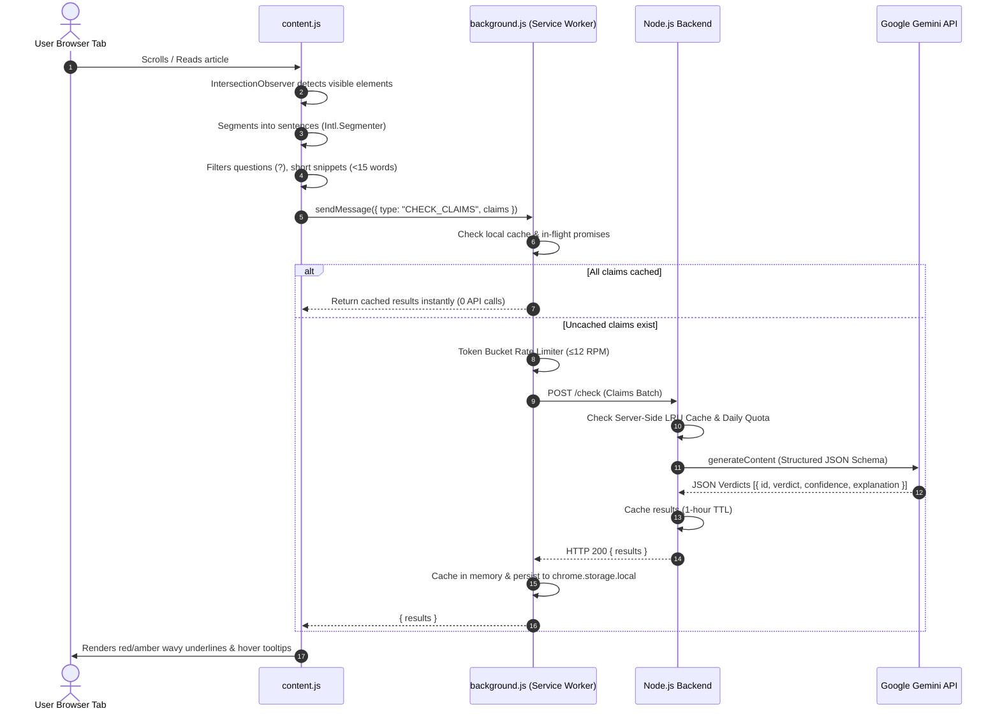

# FactLens 🔍

> **Real-Time, AI-Powered Fact-Checking for the Open Web.**  
> A lightweight Manifest V3 Chrome Extension powered by Google Gemini and a Node.js backend. FactLens highlights false, misleading, and disputed claims in real time as you browse news, social feeds, and articles.

---

## 📌 Table of Contents
- [Overview](#-overview)
- [Key Features](#-key-features)
- [How It Works](#-how-it-works)
- [Supported Platforms](#-supported-platforms)
- [System Architecture](#-system-architecture)
- [Tech Stack](#-tech-stack)
- [Engineering Best Practices & Resilience](#-engineering-best-practices--resilience)
- [Getting Started](#-getting-started)
  - [Prerequisites](#prerequisites)
  - [1. Backend Setup](#1-backend-setup)
  - [2. Chrome Extension Setup](#2-chrome-extension-setup)
- [Configuration Reference (`.env`)](#-configuration-reference-env)
- [Extension Settings](#-extension-settings)
- [Quota, Rate Limiting & Cost Management](#-quota-rate-limiting--cost-management)
- [Troubleshooting Common Issues](#-troubleshooting-common-issues)
- [License](#-license)

---

## 🚀 Overview

FactLens acts as an automated, attentive reading assistant. As you scroll through articles and social media feeds, FactLens:
1. Extracts substantive, checkable factual claims from the DOM.
2. Sends batched sentences through a throttled, cached gateway to **Google Gemini**.
3. Underlines dubious, false, or misleading statements with color-coded wavy lines directly on the page.
4. Provides interactive hover cards detailing the AI verdict, confidence rating, brief explanations, and verified source citations.
5. Summarizes the overall reliability of the page via a traffic-light indicator in the extension popup.

---

## ✨ Key Features

- **In-Page Visual Underlines**: High-contrast red and amber wavy lines mark statements categorized as *Likely false* or *Possibly misleading*.
- **Interactive Tooltip Cards**: Hovering over marked text displays:
  - Exact verdict (`Likely false`, `Possibly misleading`, etc.)
  - AI confidence percentage
  - Concise 1–2 sentence explanation of the factual dispute
  - Real citation links to reputable news, academic, or institutional sources.
- **Traffic-Light Popup Dashboard**:
  - Instant credibility rating: **Green** (No problems found), **Amber** (Caution), **Red** (Misleading/False claims found).
  - Clickable claim list: Clicking any claim in the popup smoothly scrolls the page to the statement and flashes it.
  - Coverage statistics displaying how many claims were checked vs. skipped.
- **Strict Free-Tier Protection**: Built-in client-side and server-side rate limiters, token bucket pacing, in-flight request deduplication, and 2-layer caching to prevent API quota exhaustion.
- **Zero API Key Leakage**: Your Google API key never touches browser client code; all AI communication is brokered through the local or hosted Node.js server.

---

## 🔎 How It Works



---

## 🌐 Supported Platforms

FactLens works across the open web, with tailored heuristics for popular content platforms:

| Platform | Supported Elements | Notes |
| :--- | :--- | :--- |
| **Standard Websites** | `p`, `li`, `blockquote` | News articles (BBC, Reuters, NYT), Wikipedia, Substack, Medium, personal blogs. |
| **Twitter / X** | `[data-testid="tweetText"]` | Evaluates tweet bodies while ignoring UI buttons, likes, and handles. |
| **Threads (`threads.net`)** | `[data-pressable-container] span[dir=auto]` | Deeply-nested React Native for Web post spans are parsed cleanly without breaking on mentions or tags. |
| **Social / RSS Feeds** | `[role="article"] span[dir=auto]` | Covers Mastodon, Bluesky web views, and modern feed aggregators. |

> **Note**: FactLens is optimized for **article reading pages**. Homepages (like `bbc.com` or `snopes.com` index pages) contain mostly 3-word headlines and questions (`?`), which FactLens intentionally ignores to conserve quota. Open a full article to see it scan.

---

## 🏗 System Architecture

The project is structured as a decoupled client-server architecture:

```
factlens-v2/
├── extension/                 # Chrome Manifest V3 Extension
│   ├── manifest.json          # Permissions, host grants, and entry points
│   ├── background.js          # Service worker (token bucket, cache, backend broker)
│   ├── content.js             # DOM extraction, sentence segmentation, highlighting
│   ├── content.css            # Styles for wavy underlines, banners, and tooltips
│   ├── popup.html             # Extension action popup interface
│   ├── popup.css              # Dark-mode styling for popup dashboard
│   └── popup.js               # Reactive popup logic and claim navigation
│
├── server/                    # Node.js / Express Backend
│   ├── server.js              # Express API server, Gemini client, call pacing
│   ├── package.json           # Backend dependencies and scripts
│   ├── .env.example           # Environment template with recommended defaults
│   └── .env                   # Local configuration (API keys, model, flags)
│
└── README.md                  # Project documentation
```

---

## 🛠 Tech Stack

### Frontend (Browser Extension)
- **Manifest V3**: Compliant with modern Chromium extension standards (Service Worker background lifecycle).
- **Vanilla JavaScript (ES2022+)**: Zero runtime dependencies, keeping the extension blazing fast (<100KB footprint).
- **Web APIs**:
  - `Intl.Segmenter`: Native locale-aware sentence parsing with fallback error recovery.
  - `IntersectionObserver`: Viewport-based lazy scanning (only processes text visible on screen).
  - `MutationObserver`: Debounced detection of dynamically loaded content (infinite scroll).
  - `TreeWalker` & `DOM Range`: Robust text node traversal and non-destructive `<mark>` wrapping.
  - `chrome.storage.local` & `chrome.storage.sync`: Cross-session cache persistence and settings sync.

### Backend (API Server)
- **Runtime**: [Node.js](https://nodejs.org/) (v18.0.0+)
- **Framework**: [Express 4](https://expressjs.com/)
- **SDK**: [`@google/genai`](https://www.npmjs.com/package/@google/genai) — Official Google GenAI SDK
- **Security & Utilities**:
  - `express-rate-limit`: Prevents server-side request floods.
  - `cors`: Cross-Origin Resource Sharing.
  - `dotenv`: Environment configuration management.
  - `node:crypto`: Constant-time string comparison (`timingSafeEqual`) for token validation.

### AI Engine
- **Model**: `gemini-3.8-flash`
- **Output Mode**: Structured JSON Schema (`responseMimeType: "application/json"`, strict `responseSchema`)
- **Grounding**: Optional live web search verification via `googleSearch`.

---

## 🛡 Engineering Best Practices & Resilience

FactLens is engineered with production defensive-programming patterns to ensure stability on unpredictable web pages:

1. **Hierarchy-Safe Highlighting**:
   Standard `range.surroundContents()` throws a fatal `HierarchyError` if a sentence crosses inline element boundaries (e.g. `Some <b>bold</b> text`). FactLens wraps mark operations in a `try/catch` and falls back to marking the parent container so no flagged claim is ever dropped silently.
2. **Locale-Defensive Sentence Segmentation**:
   Websites often declare malformed locale tags (e.g. `lang="en_US"` with an underscore instead of a hyphen), which causes `new Intl.Segmenter()` to throw a `RangeError`. FactLens guards initialization with automatic fallback to browser defaults.
3. **Throttled Batch Pipeline**:
   Instead of flooding the server on fast scrolling, `content.js` queues sentences and flushes **one batch at a time** with an enforced 1.5-second cooldown gap.
4. **Multi-Tier Rate Limiting (Token Bucket + Pacing)**:
   - Client worker: Token bucket capping requests at ≤12 RPM with burst capacity of 3.
   - Server: Strict call pacer enforcing ~4.1s intervals (`MIN_GEMINI_INTERVAL`) to guarantee staying under the Gemini 15 RPM free-tier threshold.
5. **Two-Layer Result Caching**:
   - **Client Cache**: LRU in-memory `Map` (600 entries) persisted to `chrome.storage.local`. Survives service-worker restarts and answers repeated sentences across tabs in 0ms.
   - **Server Cache**: In-memory cache with 1-hour TTL. Avoids duplicate Gemini queries across different users.
6. **In-Flight Request Deduplication**:
   If identical sentences enter the queue simultaneously across tabs or layout re-renders, the background worker merges them into a single pending `Promise`, preventing duplicate API burn.
7. **503 Surge Auto-Retry**:
   Google Flash models occasionally experience brief demand spikes. The server catches `503 UNAVAILABLE`, pauses for 2.5 seconds, and automatically retries before reporting an error.
8. **Prompt Injection Defense**:
   Untrusted page content is isolated within `<claims>` XML tags with explicit system instructions prohibiting instruction-following from page text.

---

## 📦 Getting Started

### Prerequisites
- [Google Chrome](https://www.google.com/chrome/) (or any Chromium browser: Brave, Edge, Opera).
- [Node.js](https://nodejs.org/) (version 18.0.0 or higher).
- A free **Google Gemini API Key** from [Google AI Studio](https://aistudio.google.com/).

---

### 1. Backend Setup

1. Open your terminal and navigate to the `server/` directory:
   ```bash
   cd factlens-v2/server
   ```

2. Install dependencies:
   ```bash
   npm install
   ```

3. Configure environment variables:
   ```bash
   cp .env.example .env
   ```
   Open `.env` in any text editor and paste your Google API key:
   ```ini
   GOOGLE_API_KEY=AIzaSyYourActualKeyHere...
   GEMINI_MODEL=gemini-3.8-flash
   ENABLE_GOOGLE_SEARCH=false
   DAILY_LIMIT=1400
   PORT=3000
   ```

4. Start the server:
   ```bash
   npm start
   ```
   You should see:
   ```text
   FactLens server on http://localhost:3000 (model gemini-3.8-flash, provider google, search off, dailyLimit 1400)
   ```

5. Verify health:
   Open [http://localhost:3000/health](http://localhost:3000/health) in your browser. You should receive:
   ```json
   {
     "ok": true,
     "model": "gemini-3.8-flash",
     "provider": "google",
     "webSearch": false,
     "daily": { "used": 0, "limit": 1400, "resetsInMin": 1440 },
     "cacheSize": 0
   }
   ```

---

### 2. Chrome Extension Setup

1. Open Google Chrome and navigate to `chrome://extensions`.
2. In the top-right corner, enable **Developer mode**.
3. Click the **Load unpacked** button (top-left).
4. Select the `factlens-v2/extension` directory.
5. FactLens will appear in your extensions list. Pin it to your toolbar for easy access.

---

## ⚙️ Configuration Reference (`.env`)

| Variable | Type | Default | Description |
| :--- | :--- | :--- | :--- |
| `GOOGLE_API_KEY` | `string` | *(Required)* | Your API Key from [Google AI Studio](https://aistudio.google.com/app/apikey). |
| `GEMINI_MODEL` | `string` | `gemini-3.8-flash` | The Gemini model identifier. Default is Google's active Flash model. |
| `ENABLE_GOOGLE_SEARCH` | `boolean` | `false` | Set to `true` to ground verdicts in live Google web search. *(Requires paid billing account; keep `false` on Free Tier to avoid instant 429 quota errors).* |
| `DAILY_LIMIT` | `number` | `1400` | Circuit breaker: maximum Gemini calls permitted per 24 hours (Free tier limit is ~1,500/day). |
| `EXTENSION_TOKEN` | `string` | `""` | Optional shared secret token to restrict access to your `/check` endpoint. |
| `PORT` | `number` | `3000` | Port for the local Express server. |

---

## 🎛 Extension Settings

Click the FactLens icon and expand **Settings** to customize behavior:

- **Text Highlight Threshold** (Default: `60%`): Minimum confidence required before applying an in-page wavy underline.
- **Min words per element** (Default: `15`): Skips short tags, buttons, captions, and bylines.
- **Min words per sentence** (Default: `7`): Skips idioms, greetings, and brief fragment sentences.
- **Max sentences per element** (Default: `4`): Limits claims checked per paragraph to control token consumption.
- **Prefer sentences with numbers/dates**: Prioritizes statements with verifiable statistics and timelines over subjective opening statements.
- **Backend URL**: Points to `http://localhost:3000` (or your remote production deployment URL).

---

## 💰 Quota, Rate Limiting & Cost Management

### Free Tier Limitations & Workarounds
| Limit | Free Tier Value | FactLens Mitigation Strategy |
| :--- | :--- | :--- |
| **Requests / Minute (RPM)** | 15 RPM | Client token bucket (12 RPM) + Server pacer (4.1s gap) ensures you never cross 15 RPM. |
| **Requests / Day (RPD)** | ~1,500 RPD | Server circuit breaker (`DAILY_LIMIT=1400`) halts requests cleanly before hard API exhaustion. |
| **Google Search Tool** | Gated / 0 Quota | `ENABLE_GOOGLE_SEARCH=false` by default; prevents immediate `429 RESOURCE_EXHAUSTED` errors. |
| **Duplicate Page Loads** | Costs tokens | 2-tier caching (Client `chrome.storage.local` + Server memory) returns repeat claims in 0ms. |

### Running on a Paid (Pay-As-You-Go) Tier
If you attach a billing account in Google Cloud:
- You can safely set `ENABLE_GOOGLE_SEARCH=true` in `.env` to enable live Google Search grounding and verified citations.
- Priority routing significantly reduces the likelihood of `503 UNAVAILABLE` demand spikes.
- You can establish a strict **Project Spend Cap** (e.g. $2.00/month) in Google Cloud Billing to guarantee you never exceed your intended budget.

---

## ❓ Troubleshooting Common Issues

### 1. Popup shows *"Unavailable: FactLens can't run on this page. Try reloading it."*
* **Cause**: You reloaded the extension in `chrome://extensions` while the tab was already open. In Manifest V3, reloading the extension invalidates existing content script connections.
* **Fix**: Refresh the web page (**F5** or **Ctrl + R**).

### 2. Terminal shows *"Check failed: 429 You exceeded your current quota"*
* **Cause**: `ENABLE_GOOGLE_SEARCH=true` is set on a Free Tier API key (Google Search grounding requires paid billing).
* **Fix**: Set `ENABLE_GOOGLE_SEARCH=false` in `server/.env` and restart the server.

### 3. Terminal shows *"Check failed: 503 This model is currently experiencing high demand"*
* **Cause**: Global traffic surge on Google's servers for that specific model.
* **Fix**: This is temporary. The server now auto-retries after 2.5 seconds. If persistent, wait 1–2 minutes and click **Retry** on the page banner.

### 4. Terminal shows *"Check failed: 404 This model is no longer available"*
* **Cause**: Deprecated model name in `.env` (e.g. `gemini-2.0-flash`).
* **Fix**: Ensure `GEMINI_MODEL=gemini-3.8-flash` in `server/.env`.

### 5. Extension does not highlight anything on the Snopes or BBC homepage
* **Cause**: Homepages contain only short 3-word headlines and questions ending in `?`. FactLens deliberately ignores questions and snippets under 15 words.
* **Fix**: Click into a **full article page** (e.g. `bbc.com/news/articles/...` or `snopes.com/fact-check/...`) and scroll through the body text.

---

## 📄 License

This project is open-source and available under the [MIT License](LICENSE).
